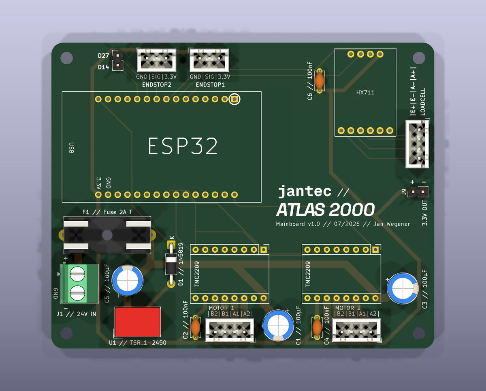
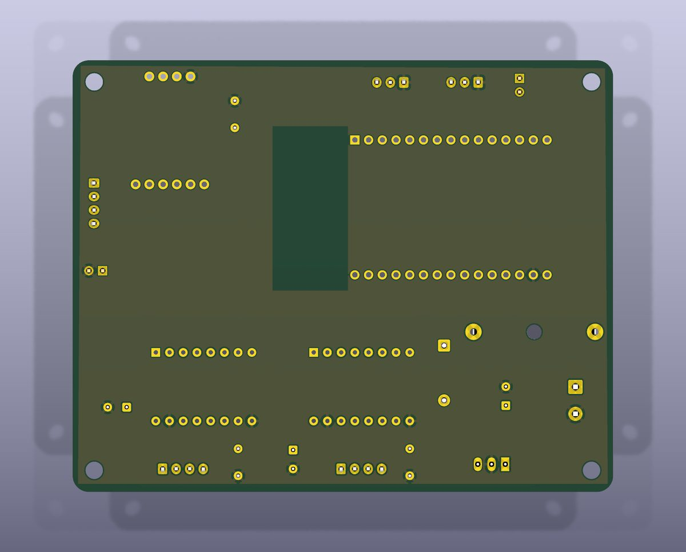

# Mainboard ATLAS - CAD sources

Custom carrier mainboard of the tensile test machine: ESP32 DevKit (2x15 header),
HX711 load-cell breakout, two TMC2209 stepper-driver breakouts, endstop and
load-cell connectors, 24 V -> 5 V / 3.3 V power.

<p align="center">
  
  
</p>

## Board

| Property | Value |
|----------|-------|
| Size / stackup | 100 x 80 mm, 2 layers, 1.6 mm |
| Design rules | min track 0.25 mm, clearance 0.2 mm, min drill 0.8 mm |
| Net classes | `POWER_24V` 2.0 mm / `POWER_5V` 1.0 mm track width |
| Parts | 25 footprints, 120 pads (THT-heavy, ~46 % front density) |
| Holes | 115 PTH (0.8 - 1.3 mm), 5 NPTH (4x M3 + 1x 2.7 mm) |
| Validation | DRC 0 errors / 2 warnings / 0 unconnected, ERC clean |

## Provenance

- Imported 2026-10-10 from the designer's KiCad 9 project.
- Re-saved 2026-10-13 with KiCad 10.0.7 (format 20260206); DRC fingerprint
  unchanged by the migration.
- `gerber/` is the manufacturing output of record (2026-07-09 fab run, plotted
  with KiCad 9.0.7: copper/mask/silk/outline + drill; the package contains no
  paste layers). Do not re-plot - regenerate only for a new spin.

## Known issues (imported legacy)

- Schematic <-> board annotation drift (44 parity findings): mounting holes are
  unannotated `REF**`, several refs carry their value (`C1 // 100µF`), and
  connectors were renumbered on the board (schematic J4-J6 vs board
  J2/J3/ENDSTOP1/2). Netlist and connectivity are correct; the refdes
  bookkeeping is what drifted.
- The 2 DRC warnings are the TMC2209 Pololu module footprints not matching the
  current KiCad 10 standard-library copy.
- Custom symbols/footprints carry no courtyard and no 3D models (they render
  as empty boards areas in the images above).

## Files

| File | Purpose |
|------|---------|
| `Mainboard-ATLAS.kicad_sch` | Main schematic (ENDSTOP1/ENDSTOP2 nets, power, HX711, drivers) |
| `Mainboard-ATLAS.kicad_pcb` | PCB layout |
| `Mainboard-ATLAS.kicad_pro` | Project settings, design rules, net classes |
| `Breakoutboards.kicad_sym` | Custom symbols (NodeMCU-ESP32, HX711, TMC2209) |
| `PEM.kicad_sym` | Unused leftover symbol lib (KY-040, LM2596, ...) from earlier experiments |
| `Breakoutboard-Footprints.pretty/` | Custom footprints (ESP32 header, HX711 breakout) |
| `fp-lib-table`, `sym-lib-table` | Library tables (`${KIPRJMOD}` relative refs) |
| `gerber/` | Fab package of record (see Provenance) |
| `img/` | Board renders (`kicad-cli pcb render`, see below) |

## Headless tooling (no GUI needed)

```bash
kicad-cli pcb drc --severity-all --format json -o /tmp/drc.json Mainboard-ATLAS.kicad_pcb
kicad-cli sch erc --format json -o /tmp/erc.json Mainboard-ATLAS.kicad_sch
kicad-cli sch export netlist --format kicadsexpr Mainboard-ATLAS.kicad_sch -o /tmp/atlas.net
kicad-cli pcb render --side top --quality high -w 1600 -o top.jpg Mainboard-ATLAS.kicad_pcb
```

Programmatic edits go through `kicad-tools` (round-trip validated for this
format); the repo gate `tools/kicad-validation/kicad_validate.py` must stay
green after any change. `kiutils` cannot parse this file format - do not use it
on these files.
